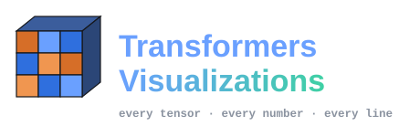
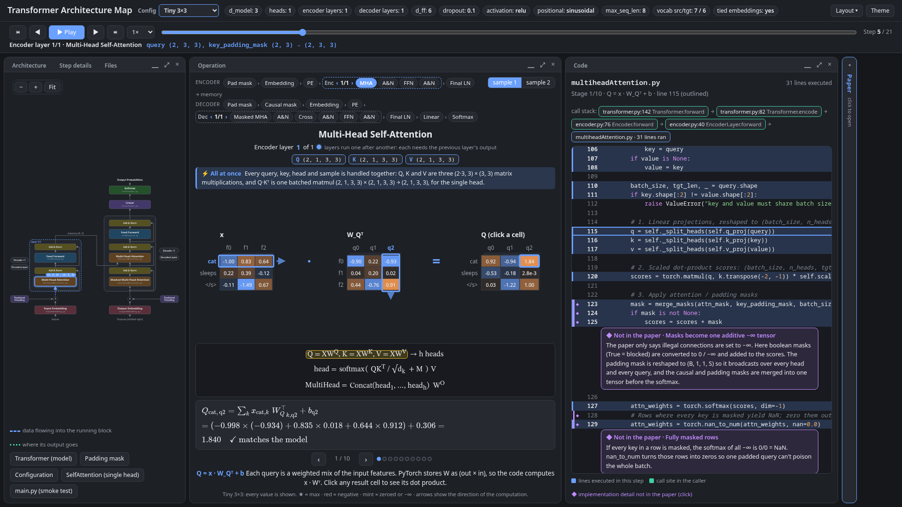
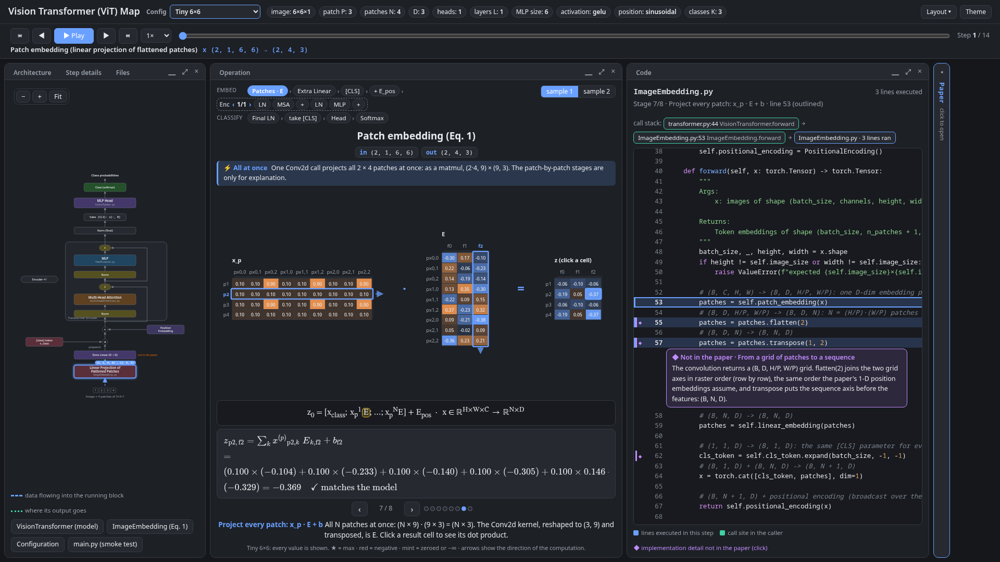

# Transformers Visualizations
<p align="center">
  
</p>


<div align="center">

[](https://www.linkedin.com/in/omarrbakr/)[](mailto:bakro0298@gmail.com)[](https://leetcode.com/u/omar_bakr/)[](https://omartbakr.github.io/)

</div>

> **Transformers Visualizations** — every tensor, every number, every line of code.

**▶ [Watch the walkthrough](encoder-decoder/demo/walkthrough.gif)** ([full-quality video](encoder-decoder/demo/walkthrough.mp4))
— the encoder–decoder Transformer, stepped through one tensor operation at a time. ([Jump to the models](#models))

Interactive, step-by-step visualizations of Transformer architectures, each generated from a **real PyTorch
forward pass**. Every operation is drawn as isometric tensors holding the actual values, its arithmetic is
written out in LaTeX and checked against what the model computed, and the exact line of code that ran it is
outlined beside it.

One folder per architecture, each with its own model code, visualization and demo material. The page
shell, the tracer and the shared tensor views live in [`shared/`](shared/), so every model is drawn the same way.

- [Models](#models)
- [Quickstart](#quickstart)
- [Repository layout](#repository-layout)
- [License](#license)

## Models

| Model | Status | Folder |
| --- | --- | --- |
| Encoder–decoder — the original Transformer, *Attention Is All You Need* | ✅ available | [`encoder-decoder/`](encoder-decoder/) |
| Vision Transformer (ViT), encoder-only — *An Image Is Worth 16x16 Words* | ✅ available | [`ViT/`](ViT/) |
| Decoder-only — GPT-style | planned | — |
| Encoder-only — BERT-style | planned | — |





## Quickstart

```bash
cd encoder-decoder      # or: cd ViT
uv sync
uv run ui/serve.py      # opens http://127.0.0.1:8765/architecture.html
```

Each model's README has its demo, every feature, how the page is generated, and how to regenerate the
walkthrough and carousel: [encoder–decoder](encoder-decoder/README.md) · [ViT](ViT/README.md).

## Repository layout

```
TransformersVisualizations/
├── shared/                 # used by every model
│   ├── py/                 # tracer.py (hooks, settrace, glue lines) · build.py · serve.py · capture.py · paper_pdf.py
│   └── ui/                 # template.html · js/dock.js · js/tensors.js · js/stage-core.js
├── encoder-decoder/        # model, ui/ (simulate, presets, notes, model.js, stage-model.js), demo/
└── ViT/                    # model, ui/ (simulate, presets, notes, model.js, stage-model.js), demo/
```

## License

MIT — see [LICENSE](LICENSE). Copyright (c) 2026 Omar Ayman Bakr.
