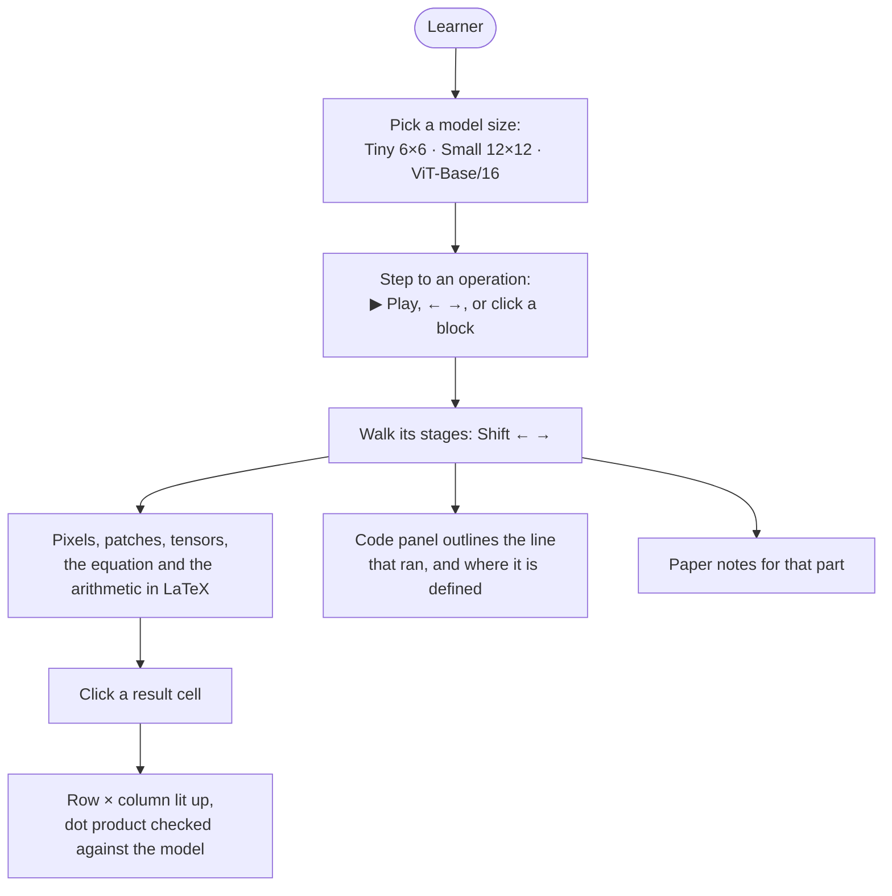
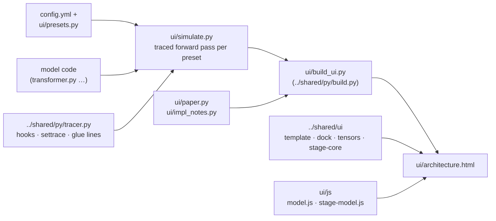

# Vision Transformer (ViT), visualized
<p align="center">
  
</p>


<div align="center">

[](https://www.linkedin.com/in/omarrbakr/)[](mailto:bakro0298@gmail.com)[](https://leetcode.com/u/omar_bakr/)[](https://omartbakr.github.io/)

</div>

> **ViT, visualized** — *An Image Is Worth 16x16 Words*, from pixels to patches to the class, one tensor operation at a time.

**▶ [Watch the walkthrough](demo/walkthrough.gif)** ([full-quality video](demo/walkthrough.mp4)) — the image cut
into patches, the patch projection worked out as a matrix multiplication, the [class] token, position embeddings,
pre-norm LayerNorm, GELU and the residual adds in LaTeX, three model sizes, and the code following every stage.
([Jump to the demo](#demo))

A step-by-step walkthrough of a **real PyTorch forward pass** through an encoder-only Vision Transformer, on
synthetic images. Each operation is drawn with the actual values (pixels, patch rows, matrices, isometric
tensors), its equation is written out with the current term highlighted, and the arithmetic is worked through
in LaTeX, then checked against what the model really computed. Each stage outlines the exact line of code
that ran it, and is linked to the part of the paper it implements.

The page is generated from a traced run of the model (forward hooks and `sys.settrace`), with nothing drawn
by hand, so changing the model changes the page. Three sizes are built side by side: **Tiny 6×6**, a grayscale
image cut into four 3×3 patches with D = 3, where every product can be checked by hand; **Small 12×12** RGB;
and **ViT-Base/16** from `config.yml`.

This implementation deviates from the paper in two places, and the page says so wherever they show up:
an **extra Linear** after the patch projection (dashed on the diagram) and **sinusoidal** position embeddings
where the paper learns them. See [Differences from the paper](#differences-from-the-paper).

- [Demo](#demo)
- [Quickstart](#quickstart)
- [Configuration](#configuration)
- [Features](#features)
- [Differences from the paper](#differences-from-the-paper)
- [Architecture](#architecture)
- [The paper](#the-paper)
- [Regenerating the demo](#regenerating-the-demo)
- [Project structure](#project-structure)
- [License](#license)

## Demo

![Walkthrough of the ViT page: the image cut into patches, a patch flattened to pixel values, the Conv2d patch projection as a matrix multiplication with a checked dot product, the extra Linear, the [class] token, position embeddings, pre-norm LayerNorm, the residual add, GELU, ViT-Base/16's 196 patches, the class softmax, and the code panel following each stage](demo/walkthrough.gif)

Captured from the running page in the dark theme. In order:

1. **The workspace**: the Operation panel in the middle, the architecture diagram beside it, the code on the
   right, all following the same step.
2. **Patches**: the image cut into P×P patches, numbered in raster order (the sequence order).
3. **Flatten**: each patch becomes one row of P²·C pixel values.
4. **Patch projection**: the Conv2d with kernel = stride = P is shown as the matmul x_p · E. Pick any cell and
   its patch row and column of E light up, with the dot product checked against the model.
5. **Extra Linear**: the layer this code adds, and why it composes with E into a single linear map.
6. **[class] token and position embeddings**: x_class prepended at position 0, then E_pos added row by row.
7. **Pre-norm encoder**: LayerNorm's μ and σ², the residual add on the un-normalized input, and GELU worked out
   as x·Φ(x) with the error function.
8. **ViT-Base/16**: a 224×224 image and its 196 patches of 16×16.
9. **Classification**: take [CLS], apply the head, softmax over the classes.
10. **The code**: each stage outlines the line that ran it, beside the implementation details the paper leaves out.

Also in [`demo/`](demo/): a 3-page [LinkedIn carousel](demo/linkedin-carousel.pdf), the
[screenshots](demo/screenshots) and a [draft post](demo/linkedin-post.md).

A learner's path through one step (the [Architecture](#architecture) section below breaks it into files):



## Quickstart

```bash
cd ViT
uv sync                 # torch, pydantic, pyyaml
uv run ui/serve.py      # builds the page, serves it on localhost, opens the browser
```

`ui/build_ui.py` alone writes `ui/architecture.html`, which also opens straight from disk, with no server.
If uv cannot create its cache directory, point it somewhere writable: `UV_CACHE_DIR=~/.cache/uv uv run ui/serve.py`.

The model runs on its own, too:

```bash
uv run main.py          # builds ViT-Base/16 from config.yml and classifies a batch of random images
```

## Configuration

The model reads every hyperparameter from `config.yml`, validated by the pydantic models in `config.py`:
a missing or misspelt key fails at load time, and so do a patch size that doesn't divide the image or a
`max_seq_len` shorter than N + 1. The page adds a few switches of its own:

| Setting | Does what |
| --- | --- |
| **Config** selector (header) | which model size the whole page runs on: `tiny`, `small` or `full` |
| `?config=` | the same, in the URL |
| `?theme=dark\|light` | the colour theme (also the **Theme** button) |
| `?layout=default\|flow\|code` | a panel layout preset (also the **Layout** menu) |
| `?sample=1\|2` | which image of the batch is drawn in front |
| `?stage=<n>` `#s=<step>` | open a specific step, and a stage within it; the links are shareable |
| `positional_encoding` in `config.yml` | `sinusoidal` (default here) or `learned` (the paper's choice) |

The presets live in `ui/presets.py`, each with a deterministic batch of two synthetic images:

| Preset | image | patches | D | heads | layers | values on the page |
| --- | --- | --- | --- | --- | --- | --- |
| **Tiny 6×6** | 6×6×1 (a vertical bar, a diagonal) | 4 of 3×3 | 3 | 1 | 1 | every value |
| **Small 12×12** | 12×12×3 (a red square, a blue ring) | 9 of 4×4 | 9 | 3 | 2 | every value, with a head selector |
| **ViT-Base/16** | 224×224×3 (a sky with a sun, a checkerboard) | 196 of 16×16 | 768 | 12 | 12 | the real `config.yml`; 16 feature dims and the first 16 tokens shown |

## Features

**From pixels to tokens**
- The image drawn pixel by pixel (with the values, for Tiny), then the patch grid in raster order
- Each patch flattened into its P²·C values, labelled by channel, row and column
- **The patch projection as a matmul:** the Conv2d's operands are recovered with `unfold` and the reshaped
  kernel, so x_p · E + b can be checked cell by cell against the convolution's real output
- The grid-to-sequence reshape (`flatten(2)`, `transpose(1, 2)`), the [class] token prepended with `expand` +
  `torch.cat`, and the position embeddings added row by row with `sin` / `cos` written out

**The encoder**
- **Pre-norm** layers as in Eq. 2–3: LayerNorm (μ, σ², x̂, γ·x̂ + β for a row you pick), multi-head
  self-attention with every score, weight and context cell checkable, and the **residual add** as its own step,
  adding back the un-normalized input
- **GELU** as x·Φ(x) = x·½(1 + erf(x/√2)) for any cell you pick, with negatives squashed rather than zeroed
- The final LayerNorm, **take [CLS]** (`x[:, 0]`), the classification head as a matmul, and the softmax over the
  classes with every exp and Σ (ViT-Base shows its 8 most likely classes)
- An **"All at once"** note on every step: the single tensor operation that computes it for every patch, head
  and image

**The code and the paper**
- Every stage outlines the line that ran it, plus the line in `__init__` that defines the layer; the call stack
  is clickable
- 18 implementation details the paper does not describe are pinned to their lines (◆): Conv2d as the
  projection E, raster-order flattening, the extra Linear, `expand` without copying, the [CLS] initialization,
  pre-norm residuals, exact GELU, sinusoidal vs learned positions, the log-space frequencies…
- Paraphrased notes for §3.1 (Eq. 1–4, inductive bias, the hybrid architecture), §3.2, Appendix A, D.3 and D.4,
  plus a comparison of ViT-Base/16 (Table 1, §4.1) with `config.yml`

**The workspace** (shared with the encoder–decoder page)
- Dockable panels with layout presets, a zoomable diagram whose blocks jump the page to their step, playback
  through every stage, keyboard control, light and dark themes

## Differences from the paper

| | Paper | This code | Why it matters |
| --- | --- | --- | --- |
| Patch projection | one linear map E (Eq. 1) | `Conv2d(kernel = stride = P)` | none: it *is* E, applied to every patch at once |
| After the projection | nothing | an extra `Linear(D → D)` | none in what the model can represent: two linear maps compose into one; it adds D² + D parameters |
| Position embeddings | learned 1-D | fixed sinusoidal (`config.yml`) | Appendix D.4 found the kind of encoding makes little difference; set `learned` to match the paper |
| Head | MLP when pre-training, Linear when fine-tuning | one Linear | the fine-tuning form |

The Conv2d is not the paper's *hybrid* model either: that one feeds patches of a CNN feature map into E. Here
there is one linear map of raw pixels, with no non-linearity and no overlapping windows.

## Architecture



`ui/simulate.py` runs one forward pass per preset, with the project modules' `get_settings()` pointed at the
preset, so the same model code is drawn at D = 3, 9 or 768. Forward hooks mark the steps that are module
calls (LayerNorm, attention, the MLP, the position embedding, the head). The ViT also has steps that are plain
lines of code: the patch projection with its flatten and transpose, the extra Linear, prepending [CLS], the two
residual adds per layer and `x[:, 0]`. The shared tracer turns these **glue lines** into steps of their own,
found by text pattern, so they keep working when lines move.

Long sequences are cut for display: ViT-Base's 197 tokens show the first 16, and every axis label says so. Values
are recorded for every layer of Tiny and Small, and for layer 1 of ViT-Base.

The page itself is the repository's shared core: the same template, tracer, layout, tensor drawing and stage
engine as the encoder–decoder. This folder adds `ui/js/model.js` (the diagram) and `ui/js/stage-model.js`
(the image, patch, [CLS], position, residual and head stages).

## The paper

The Paper panel's notes are original summaries that link to the paper's sections. None of its text, figures
or tables are reproduced: the paper carries no permission notice, so it is treated as all rights reserved,
and the diagram is drawn from scratch. Put your own copy of the PDF in `ui/` and `build_ui.py` finds each
note's passage, so the page shows your copy with those passages highlighted.

The PDF, and the `ui/paper.local.js` generated from it, are git-ignored and must not be committed or shared.
The demo material leaves the page viewer out for the same reason.

> Dosovitskiy, A., Beyer, L., Kolesnikov, A., Weissenborn, D., Zhai, X., Unterthiner, T., Dehghani, M.,
> Minderer, M., Heigold, G., Gelly, S., Uszkoreit, J., & Houlsby, N. (2021). *An Image Is Worth 16x16 Words:
> Transformers for Image Recognition at Scale.* ICLR 2021. arXiv:2010.11929.

An independent educational project, not affiliated with Google or the paper's authors.

## Regenerating the demo

```bash
uv run ui/build_ui.py
uv run demo/capture.py   # needs google-chrome and ffmpeg
```

`demo/capture.py` lists the shots; `../shared/py/capture.py` serves the page, drives headless Chrome through
them (using the URL parameters above), and writes the screenshots, the carousel PDF, `walkthrough.mp4` and
`walkthrough.gif`.

## Project structure

```
ViT/
├── config.yml / config.py      # every hyperparameter (ViT-Base/16), validated with pydantic
├── transformer.py              # VisionTransformer: embedding → encoder → [CLS] → head
├── ImageEmbedding.py           # Eq. 1: Conv2d patch projection, extra Linear, [CLS], position embedding
├── encoder.py                  # pre-norm layers (Eq. 2–3) and the final LayerNorm (Eq. 4)
├── multiheadAttention.py       # batched heads (no masks needed for images)
├── feedForward.py              # the MLP: Linear → GELU → Dropout → Linear
├── positionalEncoding.py       # sinusoidal or learned
├── main.py                     # smoke test: one forward pass from config.yml
├── ui/
│   ├── simulate.py             # the traced forward pass: hooks, glue lines, conv operands, softmax
│   ├── presets.py              # tiny / small / full and the synthetic images
│   ├── paper.py                # paper notes and where they are in your own PDF
│   ├── impl_notes.py           # details not in the paper, pinned to code
│   ├── build_ui.py / serve.py  # build the page / build and serve it (thin wrappers over ../shared/py)
│   ├── architecture.html       # generated: the whole page in one file
│   └── js/                     # model.js (diagram) · stage-model.js (ViT stages)
└── demo/                       # walkthrough, carousel, screenshots, and capture.py (shot list)
```

## License

MIT — see [LICENSE](../LICENSE). Copyright (c) 2026 Omar Ayman Bakr.
