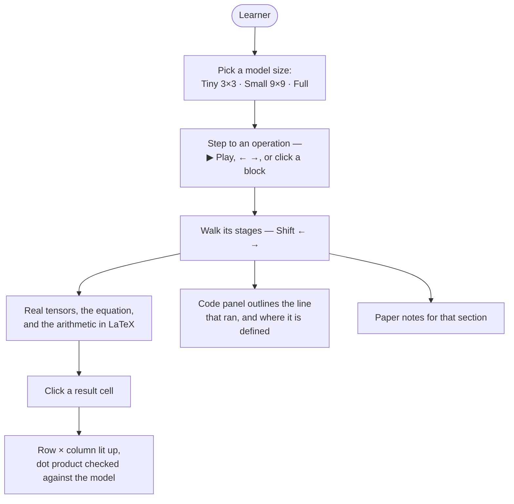
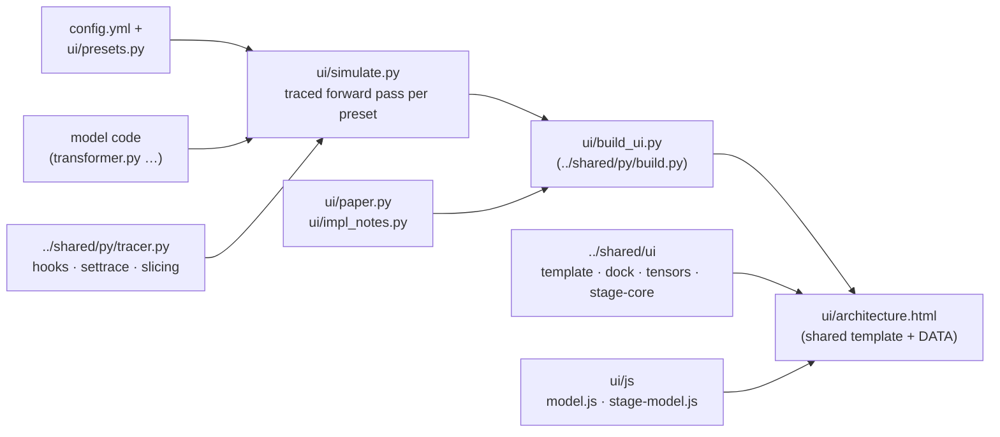

# Encoder–Decoder Transformer, visualized
<p align="center">
  
</p>


<div align="center">

[](https://www.linkedin.com/in/omarrbakr/)[](mailto:bakro0298@gmail.com)[](https://leetcode.com/u/omar_bakr/)[](https://omartbakr.github.io/)

</div>

> **Encoder–Decoder, visualized** — *Attention Is All You Need*, one tensor operation at a time.

**▶ [Watch the walkthrough](demo/walkthrough.gif)** ([full-quality video](demo/walkthrough.mp4)) — matrix
multiplications worked out cell by cell, softmax and LayerNorm written out in LaTeX, padding and masks, three
model sizes, and the code following every stage. ([Jump to the demo](#demo))

A step-by-step walkthrough of a **real PyTorch forward pass** through the original encoder–decoder Transformer.
Each operation is drawn as isometric tensors that hold the actual values, its equation is written out with the
current term highlighted, and the arithmetic is worked through in LaTeX — then checked against what the model
really computed. Each stage outlines the exact line of code that ran it, and is linked to the section of the
paper it implements.

Nothing on the page is hand-drawn: it is generated from a traced run of the model (forward hooks and
`sys.settrace`), so changing the model changes the page. Three sizes are built side by side — **Tiny 3×3**,
where every value fits on screen and every product can be checked by hand, **Small 9×9**, and the **full**
`config.yml`.

- [Demo](#demo)
- [Quickstart](#quickstart)
- [Configuration](#configuration)
- [Features](#features)
- [Architecture](#architecture)
- [What a step is made of](#what-a-step-is-made-of)
- [The paper](#the-paper)
- [Regenerating the demo](#regenerating-the-demo)
- [Project structure](#project-structure)
- [License](#license)

## Demo


Captured from the running page in the dark theme. In order:

1. **The workspace** — the Operation panel in the middle, the architecture diagram beside it, the code on the
   right, all following the same step.
2. **Embedding** — each token is copied out of a real embedding table, then scaled by √d_model.
3. **Positional encoding** — added position by position, with `x + sin(pos / 10000^{2i/d}) = y` written out.
4. **Matrix multiplication** — pick any cell of Q: its row of x (→) and column of W_Qᵀ (↓) light up, and the dot
   product is written out and checked against the model.
5. **Attention** — scores Q·Kᵀ/√d_k, then softmax in LaTeX; the padded key gets `e^{−∞} = 0`.
6. **LayerNorm** — μ and σ² along the feature axis, as fractions with the real values.
7. **ReLU** — negatives flagged, zeros in mint, the max starred.
8. **Small 9×9 and Full** — three heads with padding, then the real config's isometric tensors.
9. **Output** — next-token probabilities with every exp and Σ.
10. **The code** — each stage outlines the line that ran it, beside the implementation details the paper leaves out.

Also in [`demo/`](demo/): a 3-page [LinkedIn carousel](demo/linkedin-carousel.pdf), the
[screenshots](demo/screenshots) and a [draft post](demo/linkedin-post.md).

A learner's path through one step — what [Architecture](#architecture) below breaks into files:



## Quickstart

```bash
cd encoder-decoder
uv sync                 # torch, pydantic, pyyaml
uv run ui/serve.py      # builds the page, serves it on localhost, opens the browser
```

`ui/build_ui.py` alone writes `ui/architecture.html`, which also opens straight from disk — no server needed.
If uv cannot create its cache directory, point it somewhere writable: `UV_CACHE_DIR=~/.cache/uv uv run ui/serve.py`.

The model runs on its own, too:

```bash
uv run main.py          # builds the Transformer from config.yml and runs one forward pass
```

## Configuration

The model reads every hyperparameter from `config.yml`, validated by the pydantic models in `config.py` — a
missing or misspelt key fails at load time. The page adds a few switches of its own:

| Setting | Does what |
| --- | --- |
| **Config** selector (header) | which model size the whole page runs on: `tiny`, `small` or `full` |
| `?config=` | the same, in the URL |
| `?theme=dark\|light` | the colour theme (also the **Theme** button) |
| `?layout=default\|flow\|code` | a panel layout preset (also the **Layout** menu) |
| `?sample=1\|2` | which sentence of the batch is drawn in front |
| `?stage=<n>` `#s=<step>` | open a specific step, and a stage within it — the links are shareable |

The presets themselves live in `ui/presets.py`:

| Preset | d_model | heads | layers (enc + dec) | values on the page |
| --- | --- | --- | --- | --- |
| **Tiny 3×3** | 3 | 1 | 1 + 1 | every value; the encoder input has no `<s>`, so the shorter sentence pads within 3 tokens |
| **Small 9×9** | 9 | 3 | 2 + 2 | every value, with padding and a head selector |
| **Full** | 512 | 8 | 6 + 6 | the real `config.yml`; feature axes sampled (16 dims shown) |

## Features

**The operation stage**
- The operation running right now, and only that: its operands, the operator and the result as isometric
  tensors with named axes (batch, sequence, features) and the words along the sequence axis
- The equation with the current term highlighted, then the arithmetic in **LaTeX** with the real numbers —
  three decimals, so redoing it by hand gives the shown result
- **Matrix multiplications cell by cell:** click any result and its row of A and column of B light up, with
  arrows for the direction of the computation; the dot product is checked against the recorded value (`✓ matches the model`)
- **Softmax for any cell:** `exp(s − m) / Σ exp(…)`, with masked keys shown as `e^{−∞} = 0` and the row max `m`
  subtracted first, the way the code does it to avoid overflow
- **LayerNorm on a generic cube** first — which axis it normalises — then μ, σ², x̂ and γ·x̂ + β for a row you
  pick; the mean and variance formulas sit under the main equation
- **Special values flagged where they happen:** ReLU negatives in red and their zeros in mint, the row max ★,
  −∞ mask cells, and padded query rows dimmed with why they never matter downstream
- An **"All at once"** note on every step: which single matrix multiplication computes it for every position,
  head and sample — while the layer indicator ("Encoder layer 2 of 6") shows the layers themselves run in order

**The code**
- Every stage outlines the line that ran it, plus — for a PyTorch layer — the line in `__init__` that defines
  it; the call stack is clickable
- 15 implementation details the paper does not describe are pinned to their lines (◆): positional-encoding
  frequencies computed in log space, heads as one batched matmul, masks merged into one additive −∞ tensor,
  `nan_to_num` for fully masked rows, weight tying after initialisation…
- Notes are pinned by text patterns, not line numbers, and the build fails loudly when one goes stale

**The paper**
- Short summaries of the section each step implements, the paper's equations, and links to the section
- A comparison of the paper's base model with `config.yml` — the only difference is the learning-rate schedule
- With your own copy of the PDF in `ui/`, the passages are highlighted on the real pages (see [The paper](#the-paper))

**The workspace**
- Dockable panels: drag a tab beside, below or into another panel, drag the gaps to resize, collapse, maximise
  or close; presets **Default**, **Operation first** and **Read the code**; the layout is remembered
- A zoomable architecture diagram after Figure 1 — clicking a block jumps every panel to its step, the same
  layer first, the next layer on a second click
- Playback that walks every stage of every step, dwelling longer on stages with arithmetic; ← → by step,
  Shift ← → by stage, Space to play
- Light and dark themes, down to the dropdowns

## Architecture



`ui/simulate.py` runs one forward pass per preset. It points the project modules' `get_settings()` at the
preset for the duration of the run, so the model code needs no changes to be drawn at 3, 9 or 512 dimensions.
Forward hooks on the modules that make up the diagram mark where each step starts and ends; `sys.settrace`
records which project lines ran inside it and which tensors those lines produced.

`ui/build_ui.py` gathers the traces, the paper notes and the implementation notes into one JSON blob and
writes it into the shared page template, with every script inlined so the page is one self-contained file.
The model-independent parts live in [`../shared`](../shared) and are used by every model in the repo:
the tracer, the template, `dock.js` (the layout, no dependencies), `tensors.js` (cubes, grids and arrows sized
to their text) and `stage-core.js` (turning each step into stages, with the attention, LayerNorm,
feed-forward, softmax and matmul views). This folder adds only what is specific to the encoder–decoder:
`ui/js/model.js` (the diagram) and `ui/js/stage-model.js` (embeddings, positional encoding, masks, the
generator and the breadcrumb).

### What a step is made of

A step is one module call — one block of the diagram, in one layer. Its **sub-steps** are captured from the
run rather than written down:

- a tensor that a line assigns (`scores = …`), seen by comparing the frame's locals before and after the line
- a function's return value
- the output of a PyTorch layer (`Linear`, `Embedding`, `ReLU`), attributed to the line that called it — and,
  through `inspect`, to the line that defines it

For Tiny and Small it also keeps the operands each view needs: a Linear layer's `x`, `W` and `b`, the
embedding rows that were looked up, LayerNorm's `γ`, `β` and `ε`. LayerNorm and the final softmax run inside
PyTorch's C++, so their arithmetic is recomputed with the same operations — and has to agree with the
recorded output to be shown as matching.

Values are recorded for every layer of Tiny and Small; for Full, only layer 1 keeps values (later layers keep
shapes), which holds the page to about a megabyte and a half.

## The paper

The Paper panel's notes are original summaries linking to the paper's sections; its text is not reproduced.
Put your own copy of the PDF in `ui/` and `build_ui.py` locates each note's passage, so the page shows your
copy with them highlighted.

The PDF, and the `ui/paper.local.js` generated from it, are git-ignored and must not be committed or shared:
Google's notice in the paper grants permission to reproduce its tables and figures, with attribution, for
journalistic or scholarly works only — not full pages. The demo material leaves the page viewer out for the
same reason.

> Vaswani, A., Shazeer, N., Parmar, N., Uszkoreit, J., Jones, L., Gomez, A. N., Kaiser, Ł., & Polosukhin, I.
> (2017). *Attention Is All You Need.* NeurIPS 30. arXiv:1706.03762.

An independent educational project, not affiliated with Google or the paper's authors.

## Regenerating the demo

```bash
uv run ui/build_ui.py
uv run demo/capture.py   # needs google-chrome and ffmpeg
```

`capture.py` lists the shots; `../shared/py/capture.py` serves the page, drives headless Chrome through the views listed in `SHOTS_SPEC` (using the URL
parameters above), and writes the screenshots, the carousel PDF, `walkthrough.mp4` and `walkthrough.gif`.

## Project structure

```
encoder-decoder/
├── config.yml / config.py      # every hyperparameter, validated with pydantic
├── transformer.py              # embeddings, PE, encoder, decoder, generator (tied weights)
├── encoder.py / decoder.py     # post-norm layers and their stacks
├── multiheadAttention.py       # batched heads, masks as one additive −∞ tensor
├── selfAttention.py            # single-head reference, not used by the model
├── feedForward.py              # position-wise FFN
├── positionalEncoding.py       # sinusoidal or learned
├── inputEmbedding.py / outputEmbedding.py
├── main.py                     # smoke test: one forward pass from config.yml
├── ui/
│   ├── simulate.py             # the traced forward pass: hooks, masks, softmax, step titles
│   ├── presets.py              # tiny / small / full
│   ├── paper.py                # paper notes and where they are in your own PDF
│   ├── impl_notes.py           # details not in the paper, pinned to code
│   ├── build_ui.py / serve.py  # build the page / build and serve it (thin wrappers over ../shared/py)
│   ├── architecture.html       # generated: the whole page in one file
│   └── js/                     # model.js (diagram) · stage-model.js (model-specific stages)
└── demo/                       # walkthrough, carousel, screenshots, and capture.py (shot list)
```

## License

MIT — see [LICENSE](../LICENSE). Copyright (c) 2026 Omar Ayman Bakr.
