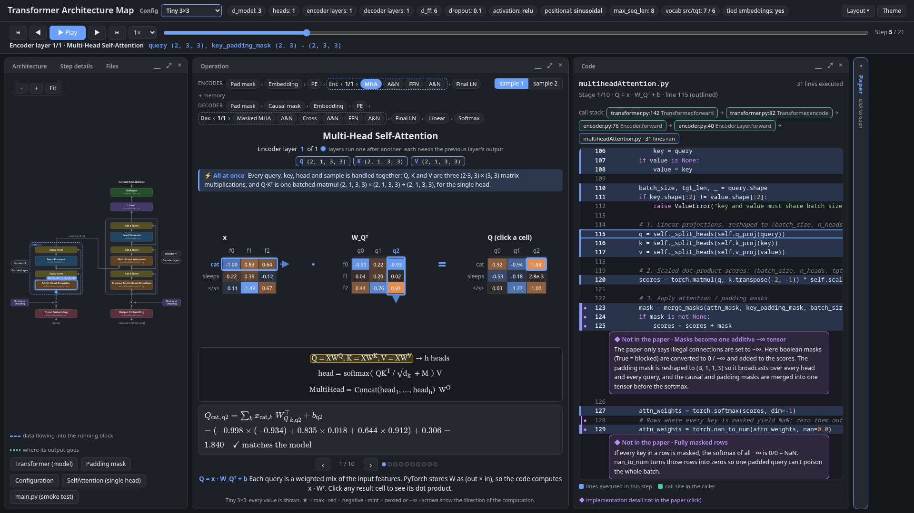

# Encoder–Decoder Transformer, visualized

An interactive, step-by-step walkthrough of a **real PyTorch forward pass** through the original encoder–decoder Transformer (*Attention Is All You Need*, Vaswani et al., 2017).

Every operation is shown as isometric tensors with real values and written out in LaTeX. Each step outlines the exact line of code that ran and is linked to the relevant section of the paper.



**Demo:** [feature tour video](demo/feature-tour.mp4) · [3-page carousel (PDF)](demo/linkedin-carousel.pdf) · [all screenshots](demo/screenshots)

---

## Features

- **A real execution trace, not drawings.** At build time the model runs on a small translation batch (en → de). The trace records what actually happened:
  - which module ran, captured with forward hooks;
  - which source lines ran, captured with `sys.settrace`;
  - the call stack, the input and output shapes, and the values of every intermediate tensor.
- **Three model sizes.** Switch between them with the **Config** selector:

  | Preset | d_model | heads | layers (enc + dec) | values shown |
  |---|---|---|---|---|
  | **Tiny 3×3** | 3 | 1 | 1 + 1 | every value; each product can be checked by hand |
  | **Small 9×9** | 9 | 3 | 2 + 2 | every value, with padding and a head selector |
  | **Full** | 512 | 8 | 6 + 6 | the real `config.yml`; feature axes are sampled |

- **The Operation panel** shows the operation that is running right now:
  - **Inputs and output:** the operand(s), the operator and the result, as isometric tensors labelled with the words;
  - **Equation:** the current term is highlighted;
  - **Stages:** a walkthrough of how the operation is computed, stage by stage.
- **Matrix multiplications, cell by cell.** Click any result cell. Its row of A (→) and column of B (↓) light up, and the dot product is written out in LaTeX and checked against the model (`✓ matches the model`).
- **The arithmetic is written out** in LaTeX, with real numbers:
  - softmax: `exp(s − m) / Σ exp(…)` for any clicked cell, with masked keys shown as `e^{−∞} = 0`;
  - LayerNorm: μ, σ², x̂ and γ·x̂ + β;
  - positional encoding: `x + sin(pos / 10000^{2i/d}) = y`;
  - embedding lookup and √d_model scaling.
- **Special values are flagged:**
  - ReLU: negatives in red, zeroed values in mint;
  - the row max: ★;
  - masks: −∞ cells;
  - padded query rows: dimmed, with an explanation of why they don't matter.
- **The code follows along.** Each stage outlines the line that ran it and the line in `__init__` where that layer is defined. It also shows the call stack and 15 implementation details that aren't in the paper (◆), e.g. computing the PE frequencies in log space, or masks as one additive −∞ tensor.
- **Paper notes.** Short summaries of the relevant section, the paper's equations, and a comparison of the paper's base model with `config.yml`. If you put your own copy of the PDF in `ui/`, the page can show it with the passages highlighted (see [The paper](#the-paper)).
- **"All at once" notes and layer indicator.** Each step explains which matrix multiplication computes it for every position, head and sample in parallel. A layer indicator (e.g. "Encoder layer 2 of 6") shows that the layers themselves run one after another.
- **Dockable workspace:**
  - drag a tab to dock it beside or below another panel, or into it as a tab;
  - drag the gaps between panels to resize them;
  - collapse, maximize or close panels;
  - choose a preset layout (**Default**, **Operation first**, **Read the code**);
  - the layout is remembered.
- **Playback:**
  - ▶ Play walks through every stage of every step;
  - **←/→** move by step;
  - **Shift+←/→** move by stage;
  - **Space** plays and pauses.
- **Architecture diagram.** A zoomable copy of Figure 1 in which every block can be clicked, with the data flow and residual arrows shown.

## Quick start

Requires Python 3.12 and [uv](https://docs.astral.sh/uv/).

```bash
cd encoder-decoder
uv sync                 # installs torch, pydantic, pyyaml
uv run ui/serve.py      # builds the page, serves it on localhost and opens your browser
```

You can also run `uv run ui/build_ui.py` and then open `ui/architecture.html` directly. It works from disk, with no server.

If uv complains that it can't create its cache directory, point it somewhere writable, e.g. `UV_CACHE_DIR=~/.cache/uv uv run ui/serve.py`.

### Shareable views (URL parameters)

```
architecture.html?config=tiny|small|full&theme=dark|light&layout=default|flow|code&sample=1|2&stage=<n>#s=<step>
```

## How it works

```
config.yml ─┐
model code ─┼─► ui/simulate.py ──► trace: steps, sub-steps, executed lines, tensors, operands
ui/presets.py┘        (hooks + sys.settrace on a real forward pass, for each preset)
                                     │
ui/paper.py, ui/impl_notes.py ───────┤  paper notes + "not in the paper" details
                                     ▼
ui/build_ui.py ──► ui/template.html + DATA ──► ui/architecture.html
                                     │
              ui/js/dock.js (layout) · ui/js/tensors.js (isometric drawing) · ui/js/stage.js (operation walkthrough)
```

- **`ui/simulate.py`** runs one traced forward pass for each preset.
  - It temporarily points the project modules at the preset's settings, so the model code is unchanged.
  - Each step records its sub-steps: tensors assigned on a line, function return values, and outputs of PyTorch layers.
  - For Tiny and Small it also records the operands each view needs (W, b, γ, β, embedding rows).
  - LayerNorm and softmax are computed inside PyTorch, so their arithmetic is recomputed explicitly with the same operations.
- **`ui/js/stage.js`** turns each step into stages. Each stage maps to a recorded sub-step, so the code panel can outline its line.
- **`ui/impl_notes.py`** pins notes to code by text patterns rather than line numbers, and the build fails loudly if they go stale.

## Project structure

```
encoder-decoder/
├── config.yml / config.py        model + training configuration (validated with pydantic)
├── transformer.py                Transformer: embeddings, PE, encoder, decoder, generator (tied weights)
├── encoder.py / decoder.py       post-norm encoder / decoder layers and stacks
├── multiheadAttention.py         multi-head attention (batched heads, additive masks)
├── selfAttention.py              single-head reference implementation
├── feedForward.py                position-wise FFN
├── positionalEncoding.py         sinusoidal / learned positional encoding
├── inputEmbedding.py / outputEmbedding.py
├── main.py                       smoke test: builds the model and runs one forward pass
├── ui/                           the visualization (see "How it works")
└── demo/                         screenshots, carousel, video, and capture.py to regenerate them
```

## Regenerating the demo assets

```bash
uv run ui/build_ui.py
uv run demo/capture.py     # needs google-chrome and ffmpeg; writes demo/screenshots, the carousel PDF and the video
```

## The paper

The notes in the Paper panel are original summaries with links to the paper's sections; the paper's text is not reproduced. If you place your own copy of the PDF in `ui/`, `build_ui.py` locates each note's passage and the page shows your PDF with those passages highlighted.

The PDF and `ui/paper.local.js`, which is generated from it, are git-ignored and must not be committed or shared. Google's notice in the paper grants permission to reproduce its tables and figures, with attribution, for journalistic or scholarly works only, and that doesn't cover full pages. For the same reason, the demo material deliberately leaves out the page viewer.

> Vaswani, A., Shazeer, N., Parmar, N., Uszkoreit, J., Jones, L., Gomez, A. N., Kaiser, Ł., & Polosukhin, I. (2017). *Attention Is All You Need.* NeurIPS 30. arXiv:1706.03762.

This is an independent educational project, not affiliated with Google or the paper's authors.

## Roadmap

This is the first model in [TransformersVisualizations](../README.md). Next are decoder-only (GPT-style) and encoder-only (BERT-style) Transformers.
